# HydroCore: Smart Water Supply and Billing System

Software Testing portfolio (Other Component), with the application under test and its complete test deliverables.

## Student details
| Name | USN |
|---|---|
| S Anandita Narayan | 1MS23IS105 |
| Vivan Raj Belur | 1MS23IS152 |

**Subject:** Software Testing

## Objectives
- Select a real-world application and identify its modules and functionalities.
- Prepare a test plan and design test cases with standard techniques (BVA, equivalence partitioning, decision tables, state transition).
- Execute the test cases, record actual results, and document defects.
- Automate testing with pytest (unit and API) and Selenium WebDriver (UI), and measure coverage.
- Keep a GitHub portfolio with meaningful commits that show progress.

## Project description
A water utility system with:
- Customer registration and login (roles: ADMIN, CUSTOMER)
- Metered connections (domestic or commercial)
- Monthly meter readings
- Tiered tariff billing: Rs 5, 8, 12 and 20 per kL by slab; commercial charges 1.5x; fixed monthly charge
- Bill lifecycle UNPAID, OVERDUE, PAID, with a due date 15 days after the bill date and a late fee
- Payments (exact amount, late fee included) with a payment history and printable receipts
- A short dashboard as the landing page, with a greeting band and one simple chart: for the admin, key money figures, a "needs attention" list and recent payments; for a customer, the amount due with Pay now and the latest bill
- Admin can open any customer to see their history (bills, payments, complaints, meter readings); the customer list has a type filter and search
- Complaints: customers report leaks, billing or supply problems; the admin moves them OPEN, IN_PROGRESS, RESOLVED
- Account security: lock-out after 5 failed sign-ins, profile page, password change
- Leak / high-usage alerts
- A web app (sign-in page, top navigation, bills, payments, complaints, profile) and a REST API (interactive docs at `/docs`)

## Screenshots
| Sign in | Customer bills |
|---|---|
| 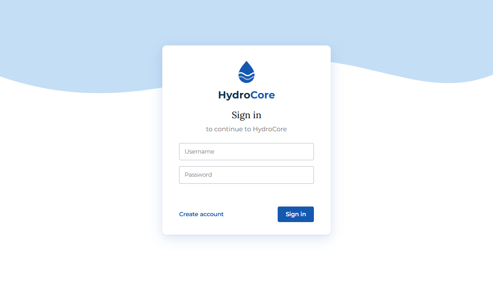 | 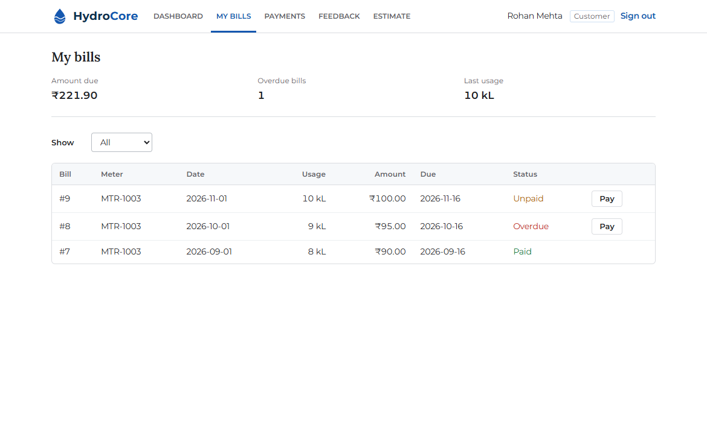 |

| Admin dashboard | Customer dashboard |
|---|---|
| 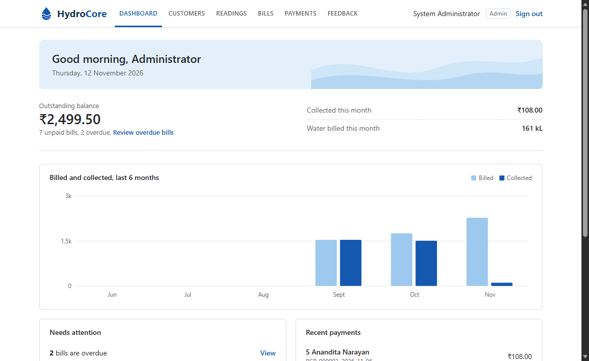 | 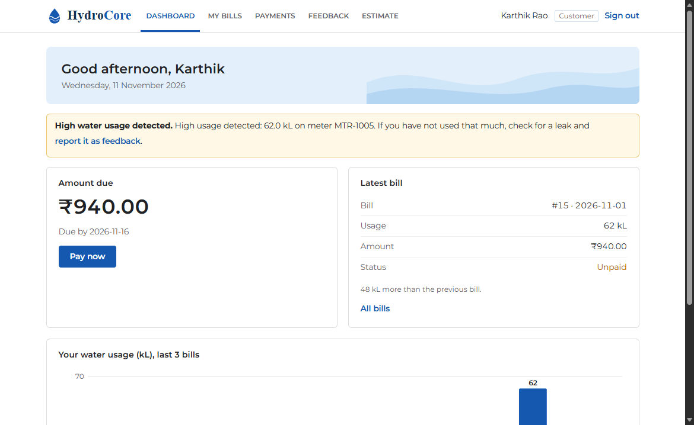 |

| Payment receipt | Admin: complaints |
|---|---|
| 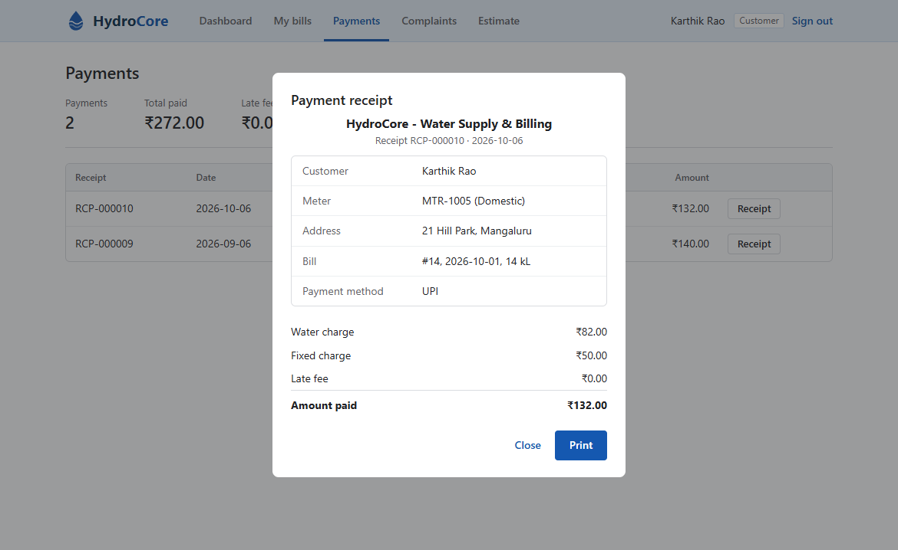 | 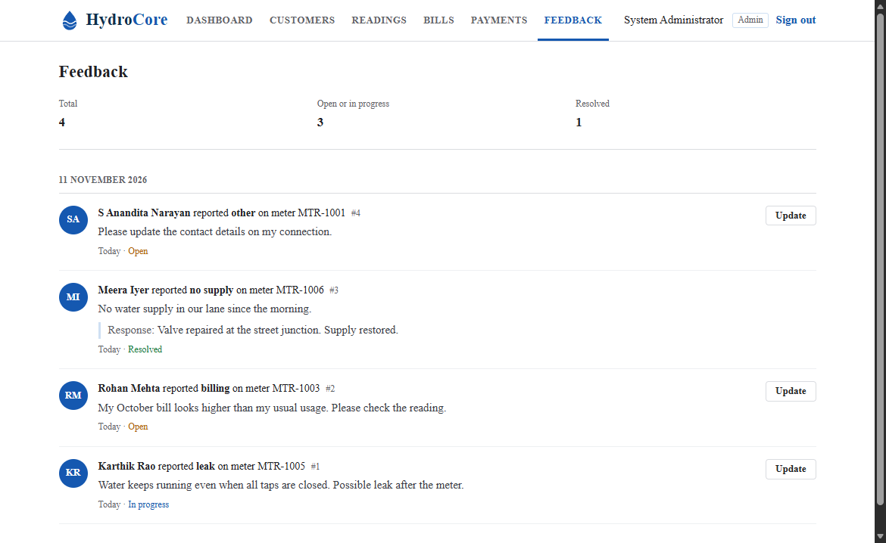 |

| Customer history | Meter readings |
|---|---|
| 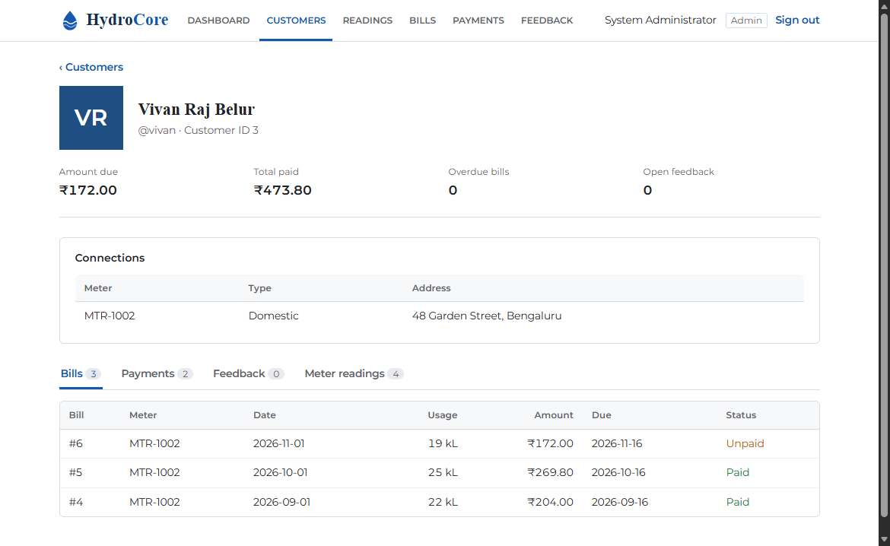 | 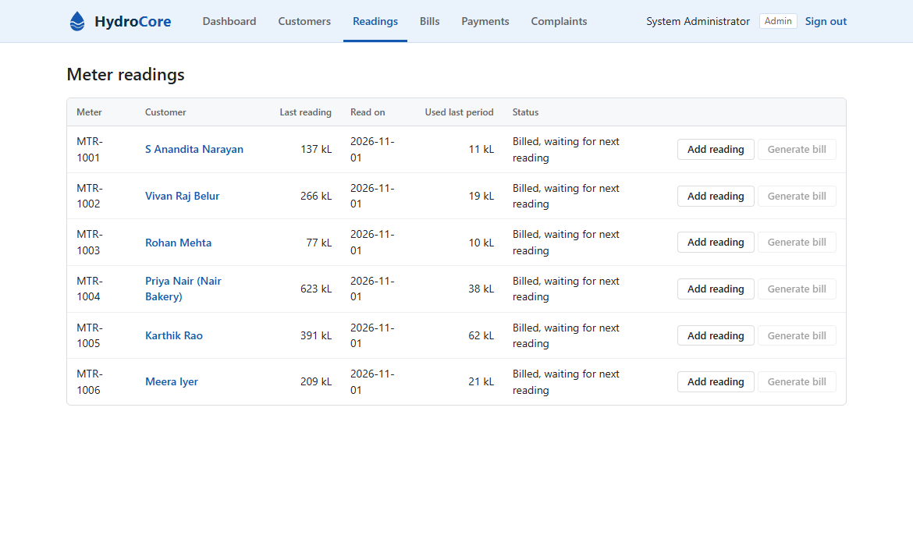 |

| Profile (three-dots menu) | |
|---|---|
| 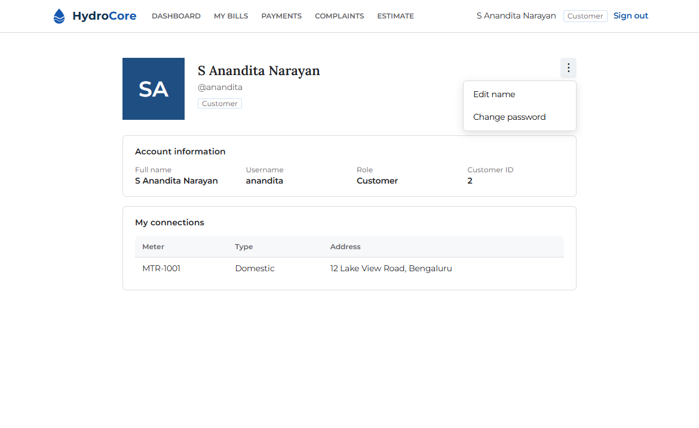 | |

| Admin: all bills | Payment dialog |
|---|---|
| 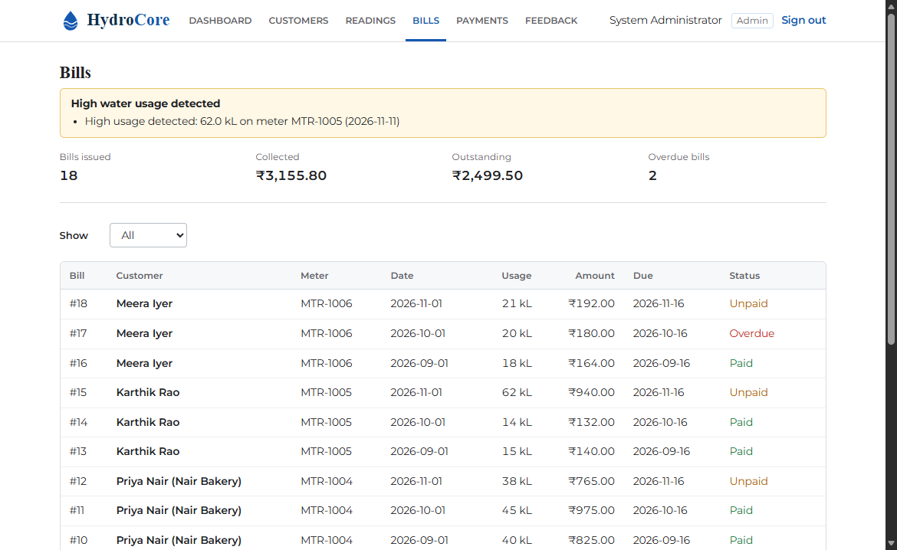 | 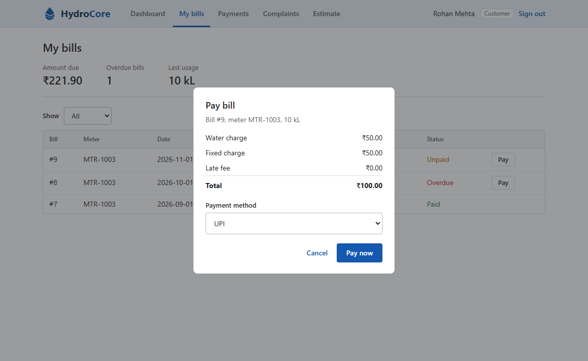 |

More are in `07_Screenshots/`.

## Results at a glance
- **175 automated test cases** (36 unit, 117 API, 22 Selenium UI): 87 of 89 passed on run 1; all 175 pass on the final run
- **5 defects** found by the tests, all fixed and retested (see `04_Defect_Reports/README.md`)
- **98%** statement coverage of the `app` package

## Run the application
```bash
pip install -r requirements.txt
uvicorn app.main:app --reload
```
Open http://127.0.0.1:8000 for the UI or http://127.0.0.1:8000/docs for the API.
An admin account is created on first start: `admin` / `admin123` (demo only).

### Load the demo data (6 customers, 18 bills, 11 receipts, 4 complaints)
```bash
python -m app.seed
```
Customers: `anandita`, `vivan`, `rohan`, `priya`, `karthik`, `meera`, all with the password `water123`.
The data has paid, unpaid and overdue bills, a late payment with a fee, a high-usage alert (karthik) and complaints in each state.
Sign in as dmin to see Payments and Complaints from the staff side, or as a customer to see the customer side.
After 5 wrong passwords an account is locked for 15 minutes.

## Run the tests
```bash
python -m pytest                               # everything (UI tests need Microsoft Edge)
python -m pytest -m "not ui"                   # unit + API only
python -m pytest --cov=app --cov-report=term   # with coverage
```

## Repository structure
```
README.md
app/                     Application source (FastAPI backend + static UI)
01_Test_Plan/            Test plan
02_Test_Case_Design/     Test cases: BVA, equivalence partitioning, decision tables, state transition
03_Test_Execution/       Execution log (run 1 vs run 2)
04_Defect_Reports/       DEF-001 to DEF-005 with a summary table
05_Test_Automation/      pytest unit/API tests and Selenium UI tests
06_Test_Reports/         JUnit XML for 14 runs, coverage output, test summary report
07_Screenshots/          Selenium screenshots
Conclusion.md
```
